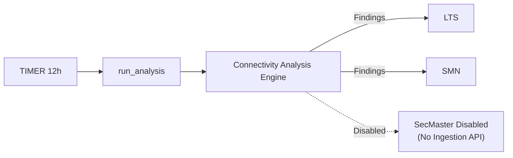

# cloud-native-security-network-access-analysis


[](LICENSE)
> A best practice for **continuous network security compliance verification** based on FunctionGraph + VPC APIs: automatically analyze VPC connectivity within a region at fixed intervals, identify access paths that do not match expectations based on predefined "Network Access Scopes", and push findings to SMN (notifications) and LTS (logs). **SecMaster batch ingestion of Findings has no API and has been disabled.**


## 1. Overview

### Introduction

This practice turns "whether a network configuration meets the security baseline" from a one-off manual investigation into an auditable, alertable, and consistently running automatic verification. It runs periodically (every 12 hours by default):

1. Load the predefined Network Access Scopes;
2. Read the topology of VPCs / subnets / route tables / security groups / ports in the region;
3. Use the built-in **configuration-level connectivity analysis engine** to determine whether non-compliant access paths exist;
4. Push Findings to SMN (notifications) and LTS (logs). **SecMaster has been disabled** and Findings are no longer ingested into it.

---

## 2. Table of Contents

- [1. Overview](#1-overview)
- [2. Table of Contents](#2-table-of-contents)
- [3. Architecture Diagram](#3-architecture-diagram)
- [4. Highlights](#4-highlights)
- [5. Cloud Services Used](#5-cloud-services-used)
- [6. Prerequisites](#6-prerequisites)
- [7. Quick Start](#7-quick-start)
- [8. Step-by-Step Deployment](#8-step-by-step-deployment)
- [9. Usage / Verification](#9-usage--verification)
- [10. Cleanup](#10-cleanup)
- [11. Detailed Explanation](#11-detailed-explanation)
- [12. Dependencies](#12-dependencies)
- [13. FAQ / Troubleshooting](#13-faq--troubleshooting)
- [14. Contributing](#14-contributing)
- [15. License](#15-license)
- [16. Contact / Maintainers](#16-contact--maintainers)

```
.
├── docs/ # Huawei Cloud practice documents
│ ├── architecture.md # Architecture description (including the architecture diagram)
│ ├── deployment-guide.md # Deployment guide
├── infra/ # Terraform + huaweicloud Provider
├── src/
│ ├── engine/ # Self-built connectivity analysis engine
│ ├── shared/ # SDK client factory + finding sinks
│ ├── functions/ # Three FunctionGraph functions
│ └── scopes/ # Scope definitions (JSON)
├── scripts/ # Packaging script package.sh
└── README.md
```

---

## 3. Architecture Diagram



See [`docs/architecture.md`](docs/architecture.md) for details.

---

## 4. Highlights

- **Periodic automatic verification**: `run_analysis` is scheduled by a TIMER trigger every 12 hours by default, with no manual intervention.
- **Configuration-level connectivity engine**: infers non-compliant paths from route tables, security groups, ports, and other configurations — no agent installation required.
- **Flexible Scope model**: supports three directions — egress / ingress / cross_vpc — to declare access paths that "should not exist".
- **Auditable findings**: every Finding is written as a structured LTS log and sent as an SMN notification, making alerting and traceability straightforward.
- **IAM agency / AK/SK dual mode**: supports a key-less agency mode and a fallback AK/SK injection mode.

---

## 5. Cloud Services Used

This practice uses the following Huawei Cloud services (specifications are subject to what is actually shown in the Huawei Cloud console):

| Service | Purpose |
|---|---|
| FunctionGraph (FGS) | Orchestrates three functions (run / check / send) |
| VPC | Topology data source of the analyzed objects |
| SMN | Findings notifications |
| LTS | Function runtime logs + structured Findings logs |
| IAM (Agency) | FunctionGraph agency authorization |
| OBS | Function code package hosting |

---

## 6. Prerequisites

- A Huawei Cloud account (real-name verified, with sufficient balance and quotas);
- Locally: Terraform >= 1.0, Python >= 3.9, `zip`, `pip`;
- Export credentials as environment variables on the deployment machine (**never write them to files**): `HW_ACCESS_KEY`, `HW_SECRET_KEY`, `HW_REGION_NAME`;
- (Optional) An SMN subscription (takes effect after `SMN_TOPIC_URN` is configured). SecMaster has been disabled, so no workspace is needed.

---

## 7. Quick Start

```bash
# 1. Build the function packages (produces infra/build/*.zip)
cd infra && bash ../scripts/package.sh

# 2. Initialize and preview
terraform init && terraform plan

# 3. Apply
terraform apply
```

---

## 8. Step-by-Step Deployment

1. **Build the function code packages**: run `bash ../scripts/package.sh` in the `infra/` directory to produce `build/*.zip`.
2. **Terraform initialization and preview**: `cd infra && terraform init && terraform plan`.
3. **Apply the deployment**: `terraform apply` (uses AK/SK injection mode by default; add `-var="create_agency=true"` for the key-less agency mode).
4. **Configure an SMN subscription** (optional): subscribe to the SMN Topic in the console to receive Findings.
5. **First manual verification**: manually "Test" the `run_analysis` function in the FunctionGraph console.

---

## 9. Usage / Verification

### Usage and Verification

1. In the FunctionGraph console, "Test" `run_analysis` and check `total_findings` / `sink` in the returned JSON;
2. Search the structured logs `NETWORK_ACCESS_FINDINGS` in the LTS log stream `vpcaa-stream`;
3. When SMN is configured, check the notifications on the subscribed endpoint;
4. Confirm the TIMER trigger status is `ACTIVE` and the next trigger time is as expected.

See [`docs/deployment-guide.md`](docs/deployment-guide.md) for details.

After deployment, follow these steps to verify that the business functionality works before considering the delivery complete.

---

## 10. Cleanup

```bash
terraform destroy
```

`destroy` only removes resources tracked in this state (the OBS bucket has `force_destroy` set). After destruction, it is recommended to confirm in the console that no leftovers remain (OBS / LTS / SMN Topic).

---

## 11. Detailed Explanation

### Security and Compliance

- **Credential security**: runtime credentials are injected by FunctionGraph through an IAM agency (temporary AK/SK/Token); no real keys appear in code or documentation;
- **Least privilege**: the IAM agency is granted only `VPC ReadOnlyAccess` + `SMN FullAccess` (SecMaster has been disabled and removed from the agency; tightening to a custom policy is recommended in production);
- **Transparent tuning**: the core analysis engine is a configuration-level approximation, reasoning only from route tables, security groups, and similar configurations, without full path-wise transitive graph inference.

---

## 12. Dependencies

- Runtime dependencies: `huaweicloudsdkcore` / `huaweicloudsdkvpc` / `huaweicloudsdksmn` / `huaweicloudsdksecmaster` (packaged into each zip);
- Huawei Cloud documentation: official documents for FunctionGraph / VPC / SMN / LTS.

---

## 13. FAQ / Troubleshooting

### FAQ

- **AK/SK written in plaintext in the state**: after deployment, it is recommended to rotate the key pair in the console so the old values in the state become invalid.
- **FSS.1501 "agency does not exist"**: when the deploying user lacks agency trust permissions, switch to method B (`create_agency=false`).

---

## 14. Contributing

Issues are welcome for bug reports or improvement suggestions. Please submit feedback through the project Issue channel.

---

## 15. License

This practice is licensed under the **MIT No Attribution** license. See the [`LICENSE`](LICENSE) file in the repository root for details.

This practice is released under the MIT-0 license. See [LICENSE](./LICENSE).

---

## 16. Contact / Maintainers
| Item | Content |
|---|---|
| **Creator** | [dgc-git](https://github.com/dgc-git) |
| **Maintainer** | [dgc-git](https://github.com/dgc-git) |
| **Contact** | GitHub Issues / PR (see [Section 14](#14-contributing)) |
