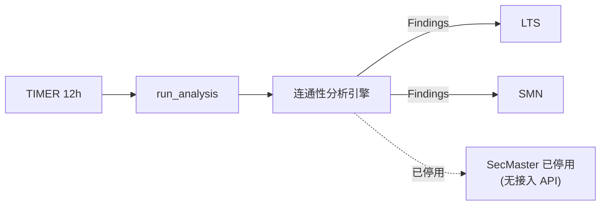

# cloud-native-security-network-access-analysis · VPC 网络访问分析自动化（华为云）


[](LICENSE)
> 基于 FunctionGraph + VPC API 的**持续网络安全合规校验**最佳实践：按固定周期自动分析区域内 VPC 连通性，依据预定义「网络访问范围（Scope）」识别不符合预期的访问路径，将发现推送至 SMN（通知）与 LTS（日志）。**SecMaster 无 Findings 批量接入接口，已停用**。


## 1. 简介 / Overview

### 简介


本实践把「网络配置是否符合安全基线」从一次性人工排查，变成可审计、可告警的常态化自动校验。它周期性（默认每 12 小时）执行：

1. 加载预定义的网络访问范围（Scope）；
2. 读取区域内 VPC / 子网 / 路由表 / 安全组 / 端口等拓扑；
3. 用自带的**配置级连通性分析引擎**判定是否存在违规访问路径；
4. 将发现（Findings）推送至 SMN（通知）与 LTS（日志）。**SecMaster 已停用**，不再灌入安全云脑。

---

## 2. 目录

- [1. 简介 / Overview](#1-简介--overview)
- [2. 目录](#2-目录)
- [3. 架构图](#3-架构图)
- [4. 方案亮点](#4-方案亮点)
- [5. 涉及云服务](#5-涉及云服务)
- [6. 前置条件](#6-前置条件)
- [7. 快速开始](#7-快速开始)
- [8. 分步部署](#8-分步部署)
- [9. 使用方法 / 验证](#9-使用方法--验证)
- [10. 清理资源](#10-清理资源)
- [11. 详细说明](#11-详细说明)
- [12. 依赖](#12-依赖)
- [13. FAQ / 故障排除](#13-faq--故障排除)
- [14. 贡献指南](#14-贡献指南)
- [15. 许可证](#15-许可证)
- [16. 联系方式 / 维护者](#16-联系方式--维护者)


```
.
├── docs/ # 华为云实践文档
│ ├── architecture.md # 架构说明（含架构图）
│ ├── deployment-guide.md # 部署指导
├── infra/ # Terraform + huaweicloud Provider
├── src/
│ ├── engine/ # 自建连通性分析引擎
│ ├── shared/ # SDK 客户端工厂 + 发现落点
│ ├── functions/ # 三个 FunctionGraph 函数
│ └── scopes/ # Scope 定义（JSON）
├── scripts/ # 打包脚本 package.sh
└── README.md
```

---

## 3. 架构图



详见 [`docs/architecture.md`](docs/architecture.md)。

---

## 4. 方案亮点

- **周期性自动校验**：默认每 12 小时通过 TIMER 触发器调度 `run_analysis`，无需人工介入。
- **配置级连通性引擎**：基于路由表 / 安全组 / 端口等配置推理违规路径，无需安装 agent。
- **Scope 模型灵活**：支持 egress / ingress / cross_vpc 三类方向，可声明"不应存在"的访问路径。
- **发现可审计**：每条 Finding 落 LTS 结构化日志 + SMN 通知，便于告警与留痕。
- **IAM 委托 / AK/SK 双模式**：支持无长期密钥的委托模式与回退 AK/SK 注入模式。

---

## 5. 涉及云服务

本实践使用以下华为云服务（规格以华为云控制台实际展示为准）：

| 服务 | 用途 |
|---|---|
| FunctionGraph（FGS） | 编排三个函数（run / check / send） |
| VPC | 被分析对象的拓扑数据源 |
| SMN | Findings 通知 |
| LTS | 函数运行日志 + 结构化 Findings 日志 |
| IAM（Agency） | FunctionGraph 委托授权 |
| OBS | 函数代码包托管 |

---

## 6. 前置条件

- 华为云账号（实名认证、余额充足、配额充足）；
- 本地：Terraform >= 1.0、Python >= 3.9、`zip`、`pip`；
- 部署机导出凭据环境变量（**切勿写入文件**）：`HW_ACCESS_KEY`、`HW_SECRET_KEY`、`HW_REGION_NAME`；
- （可选）SMN 订阅（配置 `SMN_TOPIC_URN` 后生效）。SecMaster 已停用，无需工作空间。

---

## 7. 快速开始

```bash
# 1. 构建函数包（产出 infra/build/*.zip）
cd infra && bash ../scripts/package.sh

# 2. 初始化并预览
terraform init && terraform plan

# 3. 应用
terraform apply
```

---

## 8. 分步部署

1. **构建函数代码包**：在 `infra/` 目录执行 `bash ../scripts/package.sh` 产出 `build/*.zip`。
2. **Terraform 初始化与预览**：`cd infra && terraform init && terraform plan`。
3. **应用部署**：`terraform apply`（默认走 AK/SK 注入模式；如需无密钥委托模式，加 `-var="create_agency=true"`）。
4. **配置 SMN 订阅**（可选）：控制台订阅 SMN Topic 接收 Findings。
5. **首次手动验证**：FunctionGraph 控制台手动「测试」`run_analysis` 函数。

---

## 9. 使用方法 / 验证

### 使用方法与验证


1. 在 FunctionGraph 控制台「测试」`run_analysis`，查看返回 JSON 的 `total_findings` / `sink`；
2. 在 LTS 日志流 `vpcaa-stream` 检索结构化日志 `NETWORK_ACCESS_FINDINGS`；
3. 配置了 SMN 时，在订阅终端查收通知；
4. 确认 TIMER 触发器状态 `ACTIVE`，下次触发时间符合预期。

详见 [`docs/deployment-guide.md`](docs/deployment-guide.md)。

部署完成后请按本节步骤自行验证，确认业务功能可用，方可视为交付完成。

---

## 10. 清理资源

```bash
terraform destroy
```

`destroy` 仅删除本 state 内资源（OBS 桶已设 `force_destroy`）。销毁后建议在控制台确认无残留（OBS / LTS / SMN Topic）。

---

## 11. 详细说明

### 安全与合规

- **凭据安全**：函数运行期凭据由 FunctionGraph 经 IAM 委托注入（临时 AK/SK/Token），代码与文档不出现任何真实密钥；
- **最小权限**：IAM 委托仅授予 `VPC ReadOnlyAccess` + `SMN FullAccess`（SecMaster 已停用，已从委托中移除；生产建议收紧为自定义策略）；
- **调整透明**：核心分析引擎为配置级近似，仅基于路由表、安全组等配置推理，不做全路径传递图推理。

---

## 12. 依赖

- 运行期依赖：`huaweicloudsdkcore` / `huaweicloudsdkvpc` / `huaweicloudsdksmn` / `huaweicloudsdksecmaster`（打入每个 zip 包）。
- 华为云文档：FunctionGraph / VPC / SMN / LTS 官方文档。

---

## 13. FAQ / 故障排除

### FAQ


- **AK/SK 写入 state 明文**：部署完成后建议在控制台轮换密钥对，使 state 中旧值失效。
- **FSS.1501 "agency does not exist"**：部署用户缺少委托信任权限时切换到方式 B（`create_agency=false`）。

---

## 14. 贡献指南

欢迎提交 Issue 反馈问题或改进建议。请通过项目 Issue 渠道提交反馈。

---

## 15. 许可证

本实践采用 **MIT No Attribution** 许可证，详见仓库根目录 [`LICENSE`](LICENSE) 文件。


本实践代码基于 MIT-0 许可证发布。详见 [LICENSE](./LICENSE)。

---

## 16. 联系方式 / 维护者
| 项 | 内容 |
|---|---|
| **创建者** | [dgc-git](https://github.com/dgc-git) |
| **维护者** | [dgc-git](https://github.com/dgc-git) |
| **联系方式** | GitHub Issues / PR（见[第 14 节](#14-贡献指南)） |
