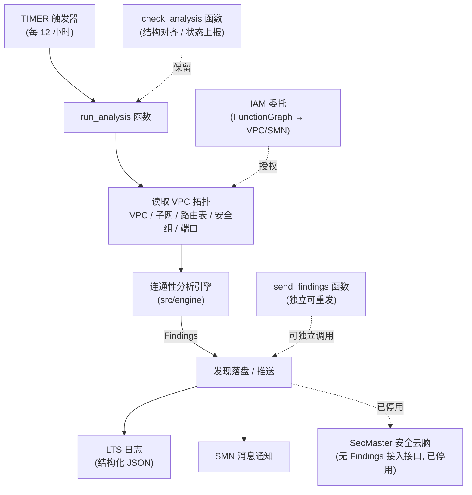

# VPC 网络访问分析自动化 — 华为云架构说明

## 1. 方案概述

本方案提供一套**持续网络安全合规校验**能力：按固定周期（默认 12 小时）自动分析指定区域内 VPC 的网络连通性，依据预定义的「网络访问范围（Scope）」识别**不符合预期的访问路径**，并将发现（Findings）集中推送到安全运营平台与安全通知渠道，便于持续监控与后续自动/人工处置。

核心价值：把「网络配置是否符合安全基线」从一次性人工排查，变成可审计、可告警的常态化自动校验。

## 2. 架构图



## 3. 组件说明

| 组件 | 华为云服务 | 职责 |
|---|---|---|
| 调度入口 | FunctionGraph **TIMER 触发器** | 按 `Rate=12h` 周期性触发 `run_analysis` |
| 分析主函数 | FunctionGraph `run_analysis` | 加载 Scope、读取拓扑、执行引擎、推送发现 |
| 状态/对齐函数 | FunctionGraph `check_analysis` | 结构对齐（同步引擎下直接返回完成） |
| 发现发布函数 | FunctionGraph `send_findings` | 可独立调用，对既有分析结果重新发布 |
| 分析引擎 | `src/engine`（Python） | 配置级可达性判定，产出 Findings |
| 权限委托 | IAM **Agency**（`op_svc_functiongraph`） | 授权函数读取 VPC、发布 SMN（SecMaster 已停用，无授权） |
| 发现落点 | **SMN** / **LTS** | 通知 / 日志（SecMaster 已停用，非落点） |
| 代码托管 | **OBS** | 存放函数代码包与 SDK 依赖层 |
| 运行日志 | **LTS** | 函数日志自动归集 |

## 4. 网络访问范围（Scope）模型

Scope 声明「哪些网络路径应当**不存在**」；任何实际存在且未被 `exclude` 排除的路径即为一条违规发现。支持三种方向：

- **egress**：实例 → 互联网（可排除特定目的 CIDR，视为有意路由）。
- **ingress**：互联网 → 实例（可排除特定目的端口，视为允许）。
- **cross_vpc**：指定 VPC → 指定 VPC（可排除特定端口，如 DNS 53）。

示例（检测除 80/443 外的入向暴露）：

```json
{
"scope_id": "all_ingress_port_80_443",
"match": { "direction": "ingress",
"source": {"type":"internet"},
"destination": {"type":"instance","value":"ALL"}, "ports": [] },
"exclude": { "cidrs": [], "ports": [80, 443] }
}
```

Scope 文件位于 `src/scopes/`，部署时随函数包一起打包；新增/调整 Scope 只需修改对应 JSON。

## 5. 设计要点与边界

- **配置级近似**：分析引擎基于路由表、安全组等**配置**推理，不做全路径传递图推理。
- **同步执行**：分析为同步计算，无需轮询；`check_analysis` 仅保留为结构对齐与未来异步后端预留。
- **发现渠道**：SMN 经 `SMN_TOPIC_URN` 启用，未配置时自动跳过；LTS 结构化日志始终产出（SecMaster 已停用，非渠道）。
- **凭据安全**：函数运行期凭据由 FunctionGraph 运行时经 IAM 委托注入（临时 AK/SK/Token），代码与文档中不出现任何真实密钥。
